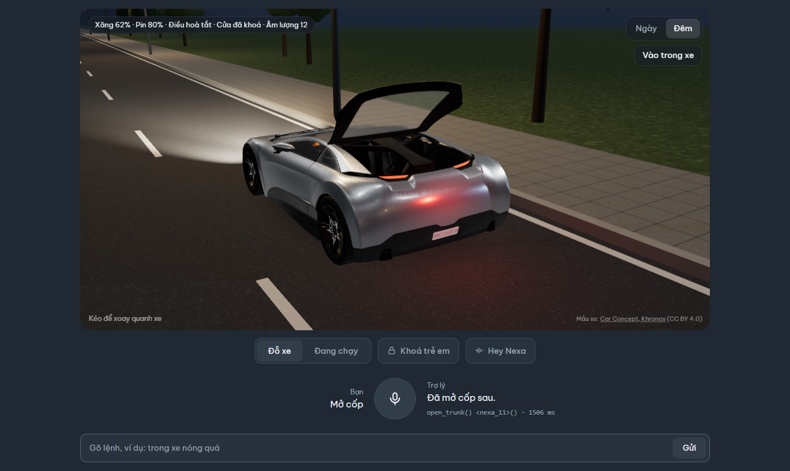
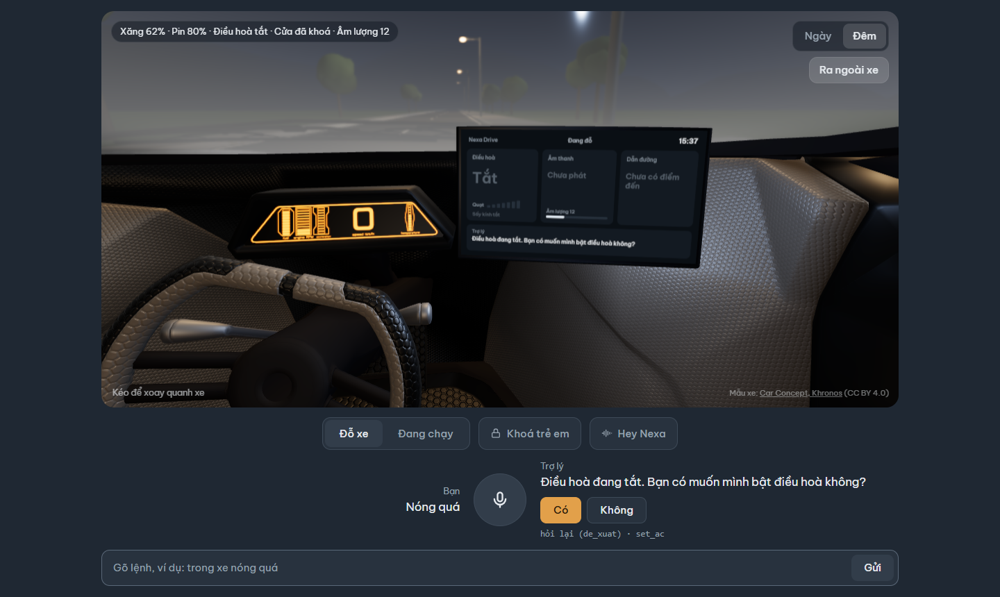
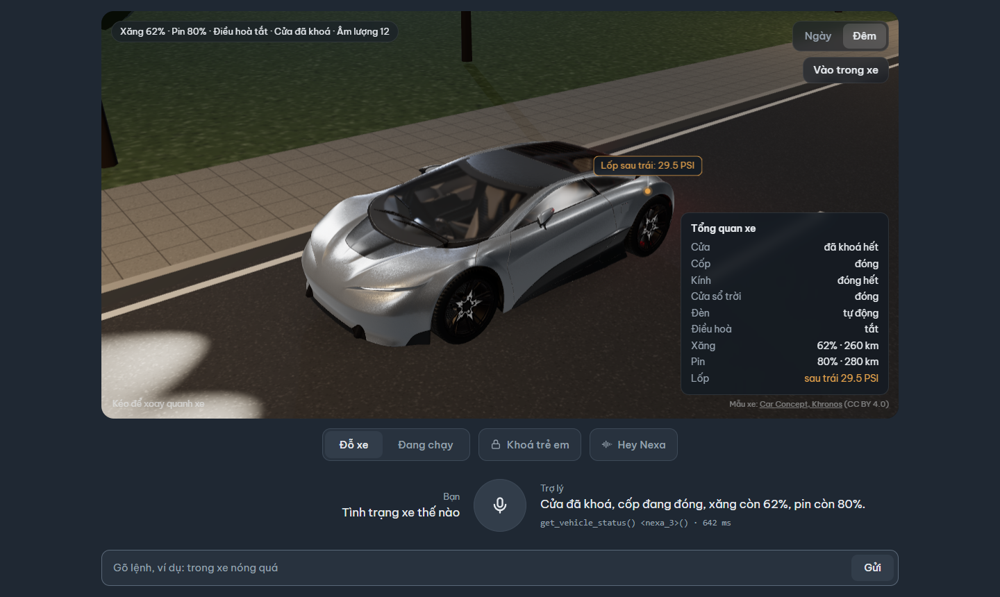
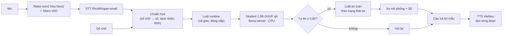
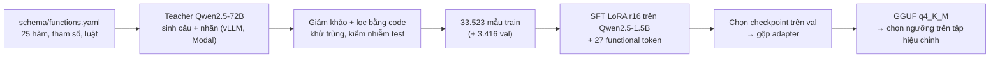

# Nexa Drive

**Trợ lý giọng nói tiếng Việt điều khiển xe ô tô, chạy hoàn toàn trên máy (CPU, không cần mạng).**

Một mô hình ngôn ngữ nhỏ **Qwen2.5-1.5B** được **chưng cất tri thức** từ **Qwen2.5-72B** và dùng kỹ thuật **functional token**:
mỗi chức năng của xe là một token riêng, nên chọn hàm chỉ cần sinh **một token** và prompt lúc chạy chỉ khoảng
**33 token** (thay vì ~2.156 token khi nhét mô tả hàm vào prompt). Bản triển khai nén **4-bit (1,04 GB)**, trả lời lượt đầu trong
**~0,46 s (p50)** trên CPU laptop.

Giao diện web gồm khung chat (gõ chữ hoặc nói), gọi rảnh tay bằng **"Hey Nexa"**, và **xe 3D** phản ứng theo câu lệnh.

| "Mở cốp" → làm luôn | "Nóng quá" → hỏi lại kèm đề xuất | "Tình trạng xe thế nào" → tổng quan xe |
|---|---|---|
|  |  |  |

---

## Ý tưởng cốt lõi

Mỗi hàm của xe (24 hàm + 1 hàm "ngoài phạm vi") được gán một token `<nexa_0>` … `<nexa_24>`, thêm `<nexa_end>` (kết thúc) và
`<nexa_ask>` (hỏi lại khi câu mơ hồ):

```
Rõ ràng     "mở cốp xe"            ->  <nexa_11>()<nexa_end>                      -> xe làm luôn
Mơ hồ       "nóng quá"             ->  <nexa_ask><nexa_6>(state="on")<nexa_end>   -> "Bạn có muốn mình bật điều hoà không?"
Ngoài pv    "kể chuyện cười đi"    ->  <nexa_24>()<nexa_end>                      -> từ chối lịch sự
```

**Model lo "hiểu", code lo "an toàn":**

- **Ngưỡng tự tin** — xác suất token đầu < 0,80 thì hỏi lại thay vì làm (ngưỡng chọn trên tập hiệu chỉnh, không chọn trên test).
- **Luật an toàn theo trạng thái xe** — ví dụ không mở cốp khi xe đang chạy; khoá trẻ em chặn kính sau / cửa sổ trời.
- **Theo nguồn lệnh** — lệnh nhạy cảm đến qua "Hey Nexa" (có thể không phải tài xế nói) phải xác nhận.

## Tính năng

| | |
|---|---|
| Gọi hàm | 24 chức năng: điều hoà, quạt gió, sấy kính, kính cửa, cửa sổ trời, đèn pha, đèn khẩn cấp, khoá cửa, cốp, nắp xăng / cổng sạc, âm lượng, phát nhạc, dẫn đường, tìm địa điểm gần, thời tiết, xem xăng / pin / áp suất lốp / quãng đường |
| Câu mơ hồ / ngoài phạm vi | hỏi lại có đề xuất cụ thể; từ chối lịch sự câu không liên quan đến xe |
| Hội thoại hai lượt | model nhận lời gọi lượt trước trong prompt ("thôi tắt đi", "phía sau thì sao") |
| Nhiều lệnh một câu | "bật đèn pha rồi mở cốp" được tách và thực hiện lần lượt |
| Giọng nói | STT **PhoWhisper-small** (int8), fine-tune thêm trên câu lệnh xe · TTS **VieNeu** đọc từng đoạn (tiếng đầu sau ~0,2 s) |
| Rảnh tay | mở trang là tự nghe "Hey Nexa"; gọi riêng "Hey Nexa" thì trợ lý chào và nghe lệnh; sau mỗi câu trả lời nghe tiếp 10 s, không cần gọi lại |
| Xe 3D | three.js, mô phỏng trạng thái xe và hoạt cảnh theo lệnh |

## Kiến trúc lúc chạy



## Quy trình huấn luyện



Mọi lựa chọn (checkpoint, mức nén, ngưỡng, phiên bản) đều làm trên **val / tập hiệu chỉnh**; **tập test đóng băng** (câu do
GPT6-Astra viết độc lập với dữ liệu train, người duyệt nhãn) chỉ dùng để báo cáo và không bao giờ sửa sau khi đã thấy điểm.

## Kết quả

**Gần bằng model 72B, nhưng chạy trên CPU laptop với model 1 GB** (test đóng băng, % đúng):

| Hệ thống | Chạy trên | Dung lượng | Prompt | Độ trễ p50 | Rõ ràng | Ngoài phạm vi | Mơ hồ dài | Câu ngắn | Hành động sai lên xe |
|---|---|---|---|---|---|---|---|---|---|
| **Nexa Drive (bản triển khai)** | **CPU laptop** | **1,04 GB** | **33 token** | **0,46 s** | 77,0 | 88,0 | **74,4** | 79,2 | **29** |
| Qwen2.5-72B + mô tả hàm | GPU A100 80 GB | ~40 GB | 2.156 token | 1,1–1,8 s | **83,8** | **94,9** | 70,5 | **91,7** | 32 |
| Qwen2.5-1.5B chưa train + mô tả hàm | GPU | 3,1 GB | 2.156 token | 0,8 s | 37,8 | 31,6 | 20,9 | 27,5 | 95 |

Độ trễ của hai model so sánh đo trên GPU A100 (vLLM), bản triển khai đo trên CPU laptop (llama.cpp). Dung lượng 72B là bản 4-bit
AWQ. Hành động sai lên xe = gọi bừa + sai hàm + sai tham số + làm luôn khi lẽ ra phải hỏi lại, trên 230 câu test sạch.

**Chi tiết theo nhóm.** Bản triển khai = v6.1 hạt giống 42, GGUF q4 + ngưỡng 0,80.

| | Rõ ràng (74) | Mơ hồ (39) | Ngoài phạm vi (117) | Mơ hồ dài (129) | Câu ngắn (120) | Hai lượt (60) | Gõ sai (104) |
|---|---|---|---|---|---|---|---|
| **Bản triển khai (q4 + 0,80, CPU)** | 77,0 | 64,1 | **88,0** | 74,4 | 79,2 | 56,7 | 47,1 |
| v6.1 s42, chưa nén, không ngưỡng | 81,1 | 74,4 | 82,9 | 79,8 | 88,3 | 66,7 | 60,6 |
| Qwen2.5-72B + mô tả hàm trong prompt | 83,8 | 56,4 | 94,9 | 70,5 | 91,7 | 81,7 | 69,2 |
| Qwen2.5-1.5B chưa train + mô tả hàm trong prompt | 37,8 | 35,9 | 31,6 | 20,9 | 27,5 | 28,3 | 21,2 |

- So với 72B (prompt dài 2.156 token, GPU A100), model 1,5B (prompt 33 token, CPU) **ngang ở câu rõ ràng, câu ngắn và câu gõ
  sai** (khác biệt không có ý nghĩa thống kê), **có xu hướng hơn ở câu mơ hồ** (72B ít hỏi lại; McNemar p 0,04–0,07 tuỳ hạt
  giống), nhưng **72B hơn rõ ở câu ngoài phạm vi** (p ≤ 0,001) **và câu hai lượt** (p 0,049 / 0,001).
- Cùng cách nhắc bằng prompt, model 1,5B chưa train chỉ đúng 21–38% — huấn luyện là phần tạo ra khác biệt.
- Ngưỡng 0,80 giảm **hành động sai lên xe** trên test sạch từ 41 xuống 29 (đổi lại hỏi lại nhiều hơn ở câu rõ ràng).

**Các mức nén** (v6.1 s42, cùng CPU 8 luồng, cùng 701 câu test):

| | f16 | q8_0 | **q4_K_M** |
|---|---|---|---|
| Dung lượng | 3,31 GB | 1,76 GB | **1,04 GB** |
| Độ trễ lượt 1 p50 / p95 | 1.062 / 2.075 ms | 856 / 1.480 ms | **463 / 832 ms** |
| Hành động sai lên xe (ngưỡng 0,80) | 29 | 29 | 29 |

8-bit gần như không mất gì so với f16; 4-bit tụt ~5 điểm ở câu mơ hồ / câu ngắn nhưng là mức duy nhất đạt mục tiêu dưới 1 giây
ở p95.

**Giọng nói** (giọng thật một người, STT gốc, 60 câu): nói đúng 38 / 60 so với gõ chữ 42 / 60. **Fine-tune STT** trên câu
lệnh xe (5.000 câu TTS nhiều giọng + FLEURS + 12 phút giọng thật) nâng số lệnh đúng trên 40 câu mới từ 24 lên 28 (gõ chữ 32;
sai từ 24,8% → 14,5%; cùng người nói với dữ liệu train, 40 câu nên chưa có ý nghĩa thống kê), không kém trên FLEURS (người
khác, câu thường). Chỉ dùng giọng TTS thì gần như không giúp. Wake-word: bắt 39 / 40 lần gọi, báo nhầm ~2,9 lần / giờ trên
3,15 giờ giọng đọc tiếng Việt liên tục (FLEURS test), không tự thức khi trợ lý đang nói.

**Đọc trả lời (TTS VieNeu, dùng sẵn):** cho VieNeu đọc 163 câu trả lời thật của hệ thống rồi để PhoWhisper-small gốc nghe lại
— câu tiếng Việt sai 3,1% số chữ (cùng STT nghe người thật đọc: 11,6%), câu có tên riêng / tiếng Anh sai 26,9%. Tiếng đầu
0,21 s, tạo tiếng nhanh hơn phát ~2,5 lần. Các số độ trễ đo khi máy ở chế độ hiệu năng cao; ở chế độ tiết kiệm điện CPU chỉ
chạy ~60% xung, TTS tạo chậm hơn phát và giọng bị ngắt quãng.

**Thí nghiệm không thành công (vẫn báo cáo):** GRPO nối sau SFT không đạt tiêu chí khoá trước; full fine-tune kém LoRA ở câu
ngoài phạm vi. Chi tiết, kiểm định McNemar và các hạn chế: [báo cáo](report/main.pdf).

## Chạy demo

Cần **Windows / Python 3.11 / Node 20+** và 3 tiến trình (lệnh PowerShell).

```powershell
# 1) Backend trợ lý — env vdk1, cổng 8000 (tự bật llama-server ở %USERPROFILE%\llama-bin)
conda activate vdk1
$env:NEXA_MO_HINH="gguf"                   # bản triển khai v6.1 s42 q4, ngưỡng 0,80, bộ nhớ của model
uvicorn serve.app:app --port 8000          # kiểm tra: http://localhost:8000/health

# 2) Dịch vụ giọng nói — env giong_noi, cổng 8001 (nạp model ~10 s)
conda run -n giong_noi uvicorn serve.giong_noi:tao_app_that --factory --port 8001

# 3) Giao diện
cd web; npm install; npm run dev           # mở http://localhost:5173
```

- **Không có model:** bỏ `NEXA_MO_HINH` → backend chạy **model giả** (luật từ khoá) để thử toàn bộ luồng và giao diện.
- **Không bật dịch vụ giọng nói:** gõ chữ vẫn dùng được; câu trả lời chỉ hiện chữ.
- **Rảnh tay:** trình duyệt chặn mic / loa tới lần tương tác đầu → bấm một lần bất kỳ đâu trên trang, rồi nói "Hey Nexa, mở cốp".
- **Laptop:** cắm sạc và bật chế độ hiệu năng cao (Windows "Best performance" + chế độ hiệu năng của hãng máy). Ở chế độ tiết
  kiệm điện CPU chạy chậm, TTS tạo tiếng chậm hơn tốc độ phát nên giọng đọc bị ngắt quãng.
- Lệnh nhạy cảm (mở khoá, mở cốp, nắp xăng, cổng sạc) nói qua "Hey Nexa" sẽ được **hỏi xác nhận** — cố ý, vì ai trong xe cũng gọi
  được; bấm nút mic thì làm luôn.

> **File model không có trong repo** (dung lượng lớn). Cần đặt: `models/gguf/lora-v61-s42-q4_k_m.gguf` + `models/gguf/tokenizer/`,
> STT `models/stt/phowhisper-small-ftB/ep3-ct2-int8/` (bản fine-tune, dùng mặc định) hoặc `models/stt/phowhisper-small-ct2-int8/`
> (bản gốc, tự dùng khi thiếu bản fine-tune), `models/wake/`. Cách tạo lại từ đầu: mục "Huấn luyện lại" bên dưới.

### Biến môi trường backend (`serve/app.py`)

| Biến | Giá trị | Ý nghĩa |
|---|---|---|
| `NEXA_MO_HINH` | `gia` (mặc định) / `gguf` | model giả hay student thật |
| `NEXA_GGUF` | mặc định `models/gguf/lora-v61-s42-q4_k_m.gguf` | dùng file GGUF khác |
| `NEXA_NGUONG` | mặc định `0.80` | ngưỡng tự tin |
| `NEXA_NHO` | `model` / `luat` | bộ nhớ lượt trước bằng model hay bằng luật (mặc định `model` với bản v6.1) |
| `NEXA_LUOT_2` | `mau` (mặc định) / `model` | câu trả lời bằng câu mẫu hay để model viết |
| `NEXA_STT` | không đặt / `goc` | dịch vụ giọng nói: mặc định bản STT fine-tune nếu có ở `models/stt/phowhisper-small-ftB/ep3-ct2-int8`, `goc` = PhoWhisper-small gốc |
| `NEXA_STT_BEAM`, `NEXA_STT_GOI_Y` | `1`, không đặt | biến thể STT |

## Cài môi trường

- **`vdk1`** (Python 3.11): `pip install -r requirements.txt` — backend, test, ruff, Modal.
- **`giong_noi`** (Python 3.11, tách riêng để không lẫn thư viện): `pip install -r requirements-giong-noi.txt`.
- **llama.cpp**: bản dựng sẵn Windows CPU (b11393) giải nén vào `%USERPROFILE%\llama-bin` (cần `llama-server.exe`). Backend đặt
  `<nexa_end>` làm token kết thúc (`--override-kv tokenizer.ggml.eos_token_id=int:151690`).
- **Node 20+** cho `web/`.

Kiểm thử: `python -m pytest -q` (963 test) và `ruff check .` trong env `vdk1`.

### Huấn luyện lại (cần tài khoản [Modal](https://modal.com), GPU A100)

```powershell
modal run train/modal_train.py::download_student          # tải Qwen2.5-1.5B-Instruct
modal run train/modal_train.py::them_token                # thêm 27 functional token
modal run --detach train/modal_train.py::lora_finetune --thu-muc-data final_v6_1 --seed 42 `
    --out-dir /vol/models/student-lora-v61-s42             # ~1 giờ / hạt giống
```

- Sinh dữ liệu bằng teacher 72B: `gen/modal_app.py`; dựng từng vòng dữ liệu: `gen/dung_vong_*.py`.
- Chuyển GGUF: `convert_hf_to_gguf.py` của llama.cpp (f16) rồi `llama-quantize … q4_K_M`.
- Đo độ tự tin / chấm bản GGUF: `eval/do_tu_tin_gguf.py`; chọn ngưỡng: `eval/nguong_v6.py`; chấm test: `eval/cham_v6.py`.
- Fine-tune STT: dữ liệu `eval/stt/ft/` (TTS, FLEURS, ghi âm), train `train/modal_stt_ft.py`; chấm cả chuỗi giọng nói
  `eval/stt/chay_stt.py` + `eval/stt/cham_chuoi.py`; đo độ rõ / tốc độ TTS `eval/tts/`.
- Token Modal lưu ở `~/.modal.toml`, không để trong repo.

## Cấu trúc thư mục

| Thư mục | Vai trò |
|---|---|
| `schema/` | **Nguồn chân lý duy nhất** — `functions.yaml` (25 hàm, mô tả, tham số, luật an toàn, hành động giao diện) + loader |
| `gen/` | Sinh dữ liệu bằng teacher 72B + giám khảo + lọc trùng; dựng các vòng dữ liệu |
| `train/` | Train trên Modal: SFT full / LoRA, gộp adapter, GRPO, sinh dự đoán; train wake-word; chuyển STT |
| `eval/` | Chấm, baseline, kiểm định McNemar, chọn ngưỡng, tập test đóng băng, đo giọng nói / wake-word, script số cho báo cáo |
| `serve/` | Backend FastAPI + WebSocket: `tac_tu.py` (xử lý một câu), `mo_hinh_gguf.py`, `an_toan.py`, `xe_mo_phong.py`, `tra_loi.py`, `giong_noi.py` (STT / TTS / wake-word) |
| `web/` | Giao diện Vite + three.js (`src/giao_dien/`) |
| `report/` | Báo cáo LaTeX (XeLaTeX / Tectonic): `main.tex`, `sec/`, `figures/` |
| `tests/` | Kiểm thử schema, định dạng lời gọi, backend, an toàn, giọng nói, GRPO |
| `notebooks/` | Notebook xem dữ liệu, đánh giá, kết quả cuối |
| `data/`, `models/`, `runs/` | Dữ liệu, model, kết quả chạy — phần lớn **không đưa lên git** (xem `.gitignore`) |

## Hạn chế

- Tập test là câu tổng hợp (GPT6-Astra viết, một người duyệt), một số nhóm nhỏ (39 câu) nên khoảng tin cậy rộng.
- 72B vẫn hơn rõ ở câu ngoài phạm vi (94,9 so với 88,0) và câu hai lượt; nén 4-bit tụt 5–10 điểm ở câu mơ hồ so với bản chưa nén.
- Giọng nói chỉ đo trên **một người nói**, phòng yên tĩnh; tiếng ồn xe là trộn nhân tạo; độ trễ đo trên CPU laptop, không phải
  phần cứng xe. Wake-word báo nhầm ~2,9 lần / giờ (mục tiêu ≤ 1). Người khác nói chen làm chuỗi giọng nói kém đi rõ rệt.
- STT fine-tune chưa học mẫu "không có lời": chữ bịa trên tiếng nền được chặn bằng ngưỡng độ tự tin, nhưng tiếng TV / người nói
  chuyện thì không chặn được.
- TTS đọc tên riêng / từ tiếng Anh (NexaAI, Playlist, PSI) theo cách đọc tiếng Việt; câu trả lời "tìm địa điểm gần" còn đọc mã nội
  bộ của xe mô phỏng.
- Đóng nắp xăng / cổng sạc đang xử lý bằng luật viết tay (schema chỉ có hàm mở); câu gõ không dấu chưa bắt được.
- Chỉ tiếng Việt; tiếng Anh là hướng phát triển.

## Giấy phép

Mã nguồn: [MIT](LICENSE). Model, dữ liệu và tài nguyên bên thứ ba giữ giấy phép riêng (dưới đây). Tập test / hiệu chỉnh đóng
băng nằm ở `data/processed/final/` để chấm lại được kết quả.

## Tham khảo và giấy phép bên thứ ba

- Octopus v2 (Chen & Li, 2024) — functional token. Qwen2.5 (Apache-2.0). PhoWhisper (VinAI). VieNeu-TTS (Apache-2.0).
- Wake-word: openWakeWord (Apache-2.0) + Silero VAD. Bộ phân loại "hey nexa" train trên giọng VieNeu, FLEURS tiếng Việt (CC BY 4.0)
  và đặc trưng ACAV100M của openWakeWord (**CC BY-NC-SA 4.0**) → model wake-word **chỉ dùng phi thương mại**.
- Mô hình xe 3D `web/public/car.glb`: Khronos glTF Sample Assets "CarConcept" (**CC BY 4.0**).
- Tiếng ồn xe: DEMAND (CC BY-SA 3.0).
